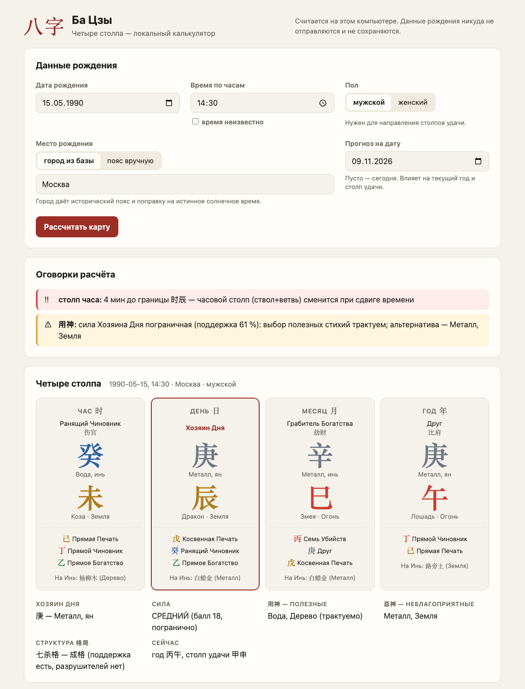

# bazi — калькуляторы и скиллы китайской и ведической метафизики

> **In English.** A Russian-language toolkit: Python calculators on Swiss Ephemeris (Ba Zi / Four Pillars, Jyotish, Human Design, Zi Wei Dou Shu, Qi Men Dun Jia, Mei Hua, Tibetan elemental astrology) plus 11 skills for LLM agents (OpenCode, Claude Code), an MCP server and a local web UI for Ba Zi. The code computes, the model only interprets; every caveat is a field in the JSON. Docs, skills and output are in Russian. License: AGPL-3.0-or-later. Version 0.1.0.

Набор Python-калькуляторов на Swiss Ephemeris плюс 11 скиллов-гайдов для LLM-агентов (OpenCode, Claude Code), которые считают **кодом**, а интерпретируют **честно**: каждое число — [факт] из JSON, каждая оговорка — поле в том же JSON, у каждого чтения — обязательная «Тень».

| Система | Калькулятор | Скилл | Что считает |
|---|---|---|---|
| Ба Цзы (八字) | `bazi.py`, `jieqi.py` | `bazi` (+ `bazi-year`, `bazi-compare`) | четыре столпа по точному 节气, скрытые стволы, 10 божеств, сила ХД, 用神/忌神, 调候, 空亡, Шэнь Ша, столпы удачи, год |
| Джйотиш | `jyotish.py` | `jyotish` | Лагна, грахи по раши/накшатрам/домам, Вимшоттари даша, базовые йоги, тропический «западный взгляд» |
| Дизайн Человека | `hd.py` | `human-design` | Тип, Стратегия, Авторитет, Профиль, центры/каналы, крест, PHS; хрупкость к минутам |
| Генные Ключи | `gene_keys.py` | `gene-keys` | 11 сфер Голограммы, Тень → Дар → Сиддхи, программные партнёры |
| Джунгци (тибетская) | `tibetan.py` | `tibetan` | год-животное + стихия, Меуа, 5 сил, обструктивные годы, Лосар (Пхугпа 1900–2100) |
| Цзы Вэй Доу Шу | `ziwei.py` | `ziwei` | 12 дворцов, 14 главных звёзд, 四化, вспомогательные звёзды — сверено с x-iztro/iztro (150 карт, 2026-11-09) |
| Ци Мэнь Дунь Цзя | `qimen.py` | `qimen` | доска 9 дворцов на момент; 拆补 (сверено с kinqimen, 300 досок) и 置闰 (`--method zhirun`, 超神接气 по 《统宗》; сверено с Ciallo, 153 доски) |
| Мэй Хуа И Шу | `meihua.py` | `meihua` | гексаграмма из чисел или момента (лунная дата через lunar-python), 本/变/互/错/综, 体用, 卦气; толкование — в скилле |
| Матрица Судьбы | `matrix.py` | `matrix` | ядро 22 арканов (полная октаграмма честно не считается) |
| Профиль по 3 системам | `compat.py`, `infographics.py` | **`profile3`** (главный), `profile3-compare` | Ба Цзы + Джйотиш + ДЧ → 4 файла + PDF; совместимость двоих |

Общий астрономический фундамент — `ephemeris.py` (swisseph, обязателен) и `ephem_core.py` (двойная сверка swisseph ↔ PyEphem). Исторические часовые пояса СССР/России и истинное солнечное время — `timezones.py` + `geo.py`: `--city Москва` сам знает, что 15 мая 1990 там было UTC+4.

## Установка

Нужен Python ≥ 3.10; полная батарея проверок гоняется на 3.12 и 3.14, установка «как у пользователя» — ещё и на 3.10. Там, где для pyswisseph нет готовой сборки, он компилируется из исходников — тогда нужен компилятор C. Проект не устанавливается как пакет: `pip install .` не поддерживается.

```bash
git clone https://github.com/aumkara/bazi-toolkit.git
cd bazi-toolkit
bash setup.sh            # .venv + pyswisseph + ephem; symlink'и скиллов в ~/.config/opencode/skills и ~/.claude/skills; ~/.bazi → эта папка; хук pre-commit; check_all.sh
```

Только калькуляторы и веб-версия, без подключения скиллов к агентам — `bash setup.sh --no-skills`.

Проект может лежать где угодно: `setup.sh` ставит symlink `~/.bazi` на его папку, и скиллы берут корень из `${BAZI_DIR:-$HOME/.bazi}`. Перенесли папку — `bash setup.sh --no-check` (перелинковка без батареи проверок). Нужен путь без symlink'а — задайте `BAZI_DIR` в окружении агента.

## Веб-версия Ба Цзы

Локальная страница без новых зависимостей — только стандартная библиотека Python:

```bash
.venv/bin/python web.py          # откроет http://127.0.0.1:8765
```



- Форма: дата, время (или «время неизвестно»), пол, город из базы или пояс вручную, дата прогноза.
- Карта — тот же `bazi.py --json`, что получают скиллы и MCP-сервер; оговорки расчёта показаны первыми.
- **Отчёт в Markdown**: галочками выбираются разделы (столпы, сила, стихии, 10 божеств, 用神/忌神, 格局, взаимодействия, звёзды, столпы удачи, текущий год, архетип столпа дня, конвенции, сырой JSON), по желанию — с графиками SVG. Кнопки «Скачать .md», «Копировать текст», «Скачать JSON». Шапка с оговорками и раздел «Чего здесь нет» входят всегда.
- Сервер слушает только `127.0.0.1`, чужие `Host`/`Origin` отклоняет; данные рождения не пишутся на диск и в лог. Страница ничего не загружает из интернета.

Тот же отчёт без браузера:

```bash
.venv/bin/python bazi.py 1990-05-15 14:30 М --city Москва --json > chart.json
python3 bazi_report.py chart.json --sections pillars,luck,year -o chart_1990-05-15_Москва.md
python3 bazi_report.py --list    # какие разделы есть
```

Отчёт — это расчёт без толкования. Толкование делает агент со скиллом `bazi`. В PDF отчёт превращает `./md2pdf.sh файл.md` (нужен Google Chrome).

## Запуск калькуляторов

```bash
.venv/bin/python bazi.py 1990-05-15 14:30 М --city Москва --json      # пояс обязателен: --city или UTC+N
.venv/bin/python jyotish.py 1990-05-15 14:30 55.75 37.62 +4 --json
.venv/bin/python hd.py 1990-05-15 14:30 +4 --json
.venv/bin/python tibetan.py 1990-05-15 --json
.venv/bin/python qimen.py 2026-04-08 14:30 UTC+3
.venv/bin/python meihua.py --numbers 17 29                                 # или --time 2026-04-08 14:30
.venv/bin/python bazi_reverse.py 庚午 辛巳 庚辰 癸未 UTC+4                      # когда бывают такие столпы (ректификация)
bash check_all.sh                                                      # вся батарея самопроверок (всё зелёное ⇒ числам можно верить)
```

Ошибки у всех калькуляторов одинаковы: код возврата `0` — результат, `2` — неверный ввод, `1` — внутренняя ошибка; сообщение идёт в stderr, а в режиме `--json` в stdout дополнительно печатается `{"error": {"kind": "input", "message": "…"}}`. Трассировка — только при `BAZI_DEBUG=1`.

В OpenCode скиллы подхватываются автоматически (ID = имя папки в `skills/`); в Claude Code — `/bazi`, `/profile3`, `/jyotish` и т. д.

## MCP-сервер

Те же JSON без скиллов и без знания пути к репозиторию — для OpenCode, Claude Desktop, Cursor и любого MCP-клиента:

```bash
.venv/bin/pip install "mcp>=2"
.venv/bin/python mcp_server.py --selftest
opencode mcp add bazi --global -- "$PWD/.venv/bin/python" "$PWD/mcp_server.py"   # локальный сервер: команда после «--»
```

Или вручную в `opencode.json(c)` клиента (пути — абсолютные, `cwd` — корень репозитория):

```jsonc
{ "mcp": { "servers": { "bazi": { "type": "local",
  "command": ["/путь/к/bazi/.venv/bin/python", "/путь/к/bazi/mcp_server.py"],
  "cwd": "/путь/к/bazi" } } } }
```

Инструменты: `bazi_chart`, `historical_utc_offset`, `jyotish_chart`, `human_design_chart`, `gene_keys_profile` (все три принимают `city` вместо координат/пояса), `tibetan_year`, `qimen_board`, `ziwei_chart`, `meihua_cast`, `bazi_find_dates` (обратный поиск дат по столпам). Новой логики в сервере нет — каждый инструмент запускает калькулятор и возвращает его `--json` целиком, включая оговорки. Отказ калькулятора приходит клиенту результатом с `isError`, все инструменты помечены как только читающие (`readOnlyHint`). `--selftest` проверяет сервер через сам протокол: в памяти и отдельным процессом по stdio.

## Проверки

`check_all.sh` — одна кнопка: окружение, версия и зависимости, размер скиллов и пути в них, `verify_all.py` (golden всех движков + кросс-системные тождества), `timezones.py --test` (56 якорей по Wikipedia/IANA), `compat.py --selftest`, `infographics.py --test`, `validate_layouts.py`, `validate_synthesis.py --test`, `bazi_report.py --test`, `web.py --selftest` (карта в вебе = `bazi.py --json`, отказы на кривой ввод и чужой `Host`), `mcp_server.py --selftest`, `check_cli_errors.py` (единый формат ошибок на заведомо плохом вводе), `--test` калькуляторов, `verify_honesty_map.py` (карта honesty-полей скилла сверяется с фактическим выводом движков), `check_public.py` (гейт утечек перед публикацией), внешние оракулы `verify_vs_*.py` (lunar-python, x-iztro, pyhd, caltib, kinqimen, Ciallo, mingpan, dashaflow — если установлены: `bash setup.sh --with-oracles`).

## Правила проекта

- **Считает код, не модель.** Скилл обязан запустить калькулятор; интерпретация — только поверх JSON.
- **Оговорки живут в JSON** (`boundary_warnings`, `tz_note`, `yongshen_borderline`, `convention_warnings`, `fragile_activations`, `losar.bazi_divergence`…) и обязаны попасть в «Тень».
- **Без подслащивания.** 忌神 — проблема, 冲 — удар, плохой период — «сиди тихо». Маркеры [факт] / [интерпретация] / [спекуляция].
- **Ветка ≠ подтверждение.** Джунгци, «западный взгляд» и Генные Ключи — ветки своих мажоров, не независимые голоса.
- **Личные данные не хранятся в репозитории.** Чтения людей (`profiles/`, `chart_*`, `Подарок_*`) — только локально, в `.gitignore`; в скиллах и тестах — нейтральные даты.

Подробности для агентов — `AGENTS.md` (его же импортирует `CLAUDE.md`). Конвенции и переключатели школ — `docs/conventions.md`; реестр источников и их статус ([факт]/[интерпретация]) — `docs/sources.md`; обзор похожих проектов — `docs/related_projects.md`.

## Участие и версии

Текущая версия — 0.1.0, изменения — в [`CHANGELOG.md`](CHANGELOG.md). Как сообщить об ошибке или предложить правку — [`CONTRIBUTING.md`](CONTRIBUTING.md); об уязвимостях — [`SECURITY.md`](SECURITY.md). Главное правило для issues и pull request'ов: никаких данных рождения реальных людей, только вымышленные даты.

## Чем это не является

Это инструмент для расчёта и изучения традиционных систем, а не источник предсказаний. Числа выверены против независимых реализаций, толкования — нет: у них нет научного подтверждения. Ничто здесь не является медицинской, психологической, финансовой или юридической рекомендацией. Дизайн Человека (1987), Генные Ключи (2009) и Матрица Судьбы (2006) — современные системы, не древние традиции.

## Лицензия и сторонние материалы

Copyright (C) 2026 Tim. Код и тексты проекта распространяются на условиях [GNU Affero General Public License](LICENSE) версии 3 или (по вашему выбору) любой более поздней — `AGPL-3.0-or-later`; в файлах кода стоит строка `SPDX-License-Identifier`. Программа поставляется без каких-либо гарантий. Причина выбора: обязательная зависимость [pyswisseph](https://github.com/astrorigin/pyswisseph) (Swiss Ephemeris, Astrodienst) распространяется под AGPL-3.0. Если вы запускаете изменённую версию как сетевой сервис, AGPL обязывает дать пользователям её исходный код.

Зависимости в репозиторий не вложены — они ставятся из PyPI (`requirements.txt`, для оракулов — `requirements-dev.txt`). Сторонние данные:

- `oracles/hexagrams_kingwen_wikipedia.json` — таблица 64 гексаграмм, извлечённая из статьи Wikipedia [«List of hexagrams of the I Ching»](https://en.wikipedia.org/w/index.php?title=List_of_hexagrams_of_the_I_Ching&oldid=1344901076) (авторы Wikipedia, ревизия 1344901076). Этот файл — сторонние данные под лицензией [CC BY-SA 4.0](https://creativecommons.org/licenses/by-sa/4.0/), а не под AGPL; что именно взято и что отброшено, записано в самом файле;
- `losar_provenance/` — даты Лосара, вычисленные по формулам статьи Svante Janson «Tibetan calendar mathematics» (arXiv:1401.6285); сама статья и её исходник в репозиторий не входят;
- остальные источники и их статус — в `docs/sources.md`.
